# K-POP DATA LAB

기준일: 2026-10-20 · 기준 브랜치: `feature/kpop-news-analysis`
최종 확인된 원격 커밋(Work 최종 기록): `7961a491dfa373def77d192655d19cceb03c7819`.
이 문서는 현재 로컬 코드와 Work 기록을 대조했다. 반영 직전 로컬 작업 트리가 깨끗하고 브랜치·HEAD가 위 기준과 일치함을 확인했다. 현재 원격은 재조회하지 않았으며 원격 커밋은 Work 최종 기록을 기준으로 한다.
현재 런타임은 **MySQL + SQLite + 근거 파일**이다. PostgreSQL은 준비 단계이며 Vercel·Supabase 배포는 미완료다. 공개 서비스 URL은 없다.

## 1. 프로젝트 소개

MBC AI 데이터 저널리즘 수업의 K-POP 차트 분석·기사 작성 실습 웹서비스다. 팬과 음악 산업 독자에게 수치의 출처·측정 기간·한계를 설명하고, 기자와 편집자가 근거를 확인한 뒤 기사를 승인하도록 돕는다.

학습 흐름은 `수집 → 저장 → 조회 → 분석 → 시각화 → Fact Sheet → 기사 초안 → 사람 검수`다. AI 생성만으로 공개 기사 승인이 이루어지지 않는다.

STEP 26B Full Dark Glass UI와 실제 브랜드 파비콘(SVG, 16/32px PNG, Apple touch icon)을 적용했다. STEP 26C에서는 READER 개인 분석, 선택곡 개수·추가 버튼, 주간 지표와 누적 지표 분리, AI News 결과 전환을 보완했다.

기존 README의 학습 내용과 개발 기록은 [이전 README 보존본](docs/README-learning-history-before-refresh.md)에 별도 문서로 보존했으며, 문서 이동에 따라 상대 링크를 보정했습니다. 보존본의 숫자 예시·로그 스케일·옛 파일 구조·체크리스트는 역사 자료이며 현재 명세가 아니다.

## 2. 기능정의서

| 기능 | 입력·사용자 | 현재 동작·제약 | 코드 |
|---|---|---|---|
| 검색·선택 | 로그인 사용자, 아티스트·주차·곡 | 선택 비교 기간의 금주 Spotify Top 200 검색, 최대 10명·10곡 | app.py |
| 개인 분석 | READER 포함 모든 역할 | 기존 데이터 선택·개별 제거·초기화, 사용자별 SQLite selection 보존. 원본 수집·삭제와 구분 | app.py, security/auth.py |
| 원본 수집·저장 | STAFF(JOURNALIST·EDITOR·ADMIN) | 기존 /add-analysis는 MySQL 쓰기·YouTube API 호출 가능, 개인 선택 경로와 분리 | app.py, security/auth.py |
| 주간 비교 | 검증된 연속 2주 CSV | Spotify 주간 스트리밍·YouTube 공식 주간 곡 조회수, 플랫폼별 전주/금주 그래프 | news/weekly_chart_analysis.py |
| 영상 누적 통계 | 기존 영상 통계·검수 자료 | 영상별 누적 조회수·좋아요·댓글을 별도 표시 | news/youtube_display_resolver.py |
| AI News | STAFF, 주차·Fact Sheet | 데이터 근거·무료 기사 미리보기·과거 사례 및 고급 도구, 유료 호출 별도 확인 | news/news_routes.py, news/generation.py |
| 기사 편집·승인 | 작성자와 다른 EDITOR/ADMIN | 작성·수정·검수 요청·보류·승인·철회, 버전·근거·이력 보존 | news/editorial.py |
| 영상 후보·검수 | EDITOR·ADMIN | 영상 정체성 사람 검수, 승인·잠금·정정 기록 | news/youtube_video_review_step17b.py |
| 역할 관리 | ADMIN | 서버 RBAC, 세션 해제·감사 기록, 마지막 ADMIN 보호 | security/auth.py, security/admin.py |

READER는 개인 분석과 승인 기사 조회가 가능하며 AI News·기사 작성·검수·역할 변경은 불가하다. JOURNALIST는 기사 작성이 가능하고, EDITOR·ADMIN은 다른 작성자의 기사를 검수한다. ADMIN만 역할을 변경한다. 버튼 표시뿐 아니라 서버에서 권한을 검사한다.

Work 최종 확인 당시 `kpop_admin=ADMIN`, `fiera77=READER`였다. 이번 작업에서 운영 계정 상태를 재조회하거나 변경하지 않았다. [역할 운영 절차](docs/step26c-role-operations.md)를 따른다.

## 3. 화면구성도

```text
/account  회원가입·로그인
  └─ / Dashboard (Full Dark Glass)
      ├─ 아티스트 검색·곡 선택·선택 개수·추가
      ├─ Current Analysis · 개별 제거 · 초기화
      ├─ Spotify / YouTube 주간 자료·기간 선택
      ├─ Compare / 전주·금주 플랫폼별 그래프
      ├─ 영상 누적 통계 (주간 차트와 분리)
      └─ AI News · 근거 · 무료 미리보기 · 과거 사례 · 고급 도구
/editorial  기사 작성·검수·ADMIN 역할 관리
/api/editorial/published  승인 기사 조회
```

기존 `/spotify`, `/youtube`, `/compare` 경로도 남아 있다. 화면은 `templates/`, 스타일·동작·파비콘은 `static/`에 있다. 파비콘 실파일은 `static/icons/favicon.svg`, `favicon-16x16.png`, `favicon-32x32.png`, `apple-touch-icon.png`다.

스크린샷은 저장소 내 배포용 경로가 확인되지 않아 여기에는 삽입하지 않는다. 실제 Work 캡처 및 검증 보고서 위치는 별도 로컬 변경 검토 보고서에 기록했다. 임의 이미지 경로나 공개 URL을 만들지 않는다.

## 4. DB 설계 및 Mermaid ERD

| 저장소 | 테이블·내용 | 기준 |
|---|---|---|
| MySQL 8.0 | tracks, spotify_chart, youtube_stats | mbc_kpop_data.sql |
| SQLite | users, sessions, login_limits, fact_reviews, articles, revisions, reviews, audit | db/migrations/002_editorial_sqlite.sql |
| 파일 | 주간 CSV·Manifest·Fact Sheet·기사 원본·영상 승인/잠금/정정 JSON | news/, data/, facts/, articles/ |

```mermaid
erDiagram
    tracks ||--o{ spotify_chart : song_id
    tracks ||--o{ youtube_stats : song_id
    users ||--o{ sessions : user_id
    users ||--o{ fact_reviews : reviewer_id
    users ||--o{ articles : author_id
    users ||--o{ revisions : actor_id
    users ||--o{ reviews : reviewer_id
    users o|--o{ audit : actor_id
    articles ||--o{ revisions : article_id
    articles ||--o{ reviews : article_id
    tracks {
        INT song_id PK
        VARCHAR artist
        VARCHAR track
    }
    spotify_chart {
        INT spotify_id PK
        INT song_id FK
        INT spotify_rank
        BIGINT spotify_streams
        DATE chart_date
        DATETIME collected_at
    }
    youtube_stats {
        INT youtube_id PK
        INT song_id FK
        VARCHAR youtube_video_id
        BIGINT youtube_views
        BIGINT youtube_likes
        BIGINT youtube_comments
        DATETIME collected_at
    }
    users {
        INTEGER id PK
        TEXT username UK
        TEXT password_hash
        TEXT role
        TEXT selection
    }
    articles {
        INTEGER id PK
        INTEGER author_id FK
        TEXT fact_ref
        TEXT evidence_hash
        INTEGER version
        TEXT status
    }
    login_limits {
        TEXT key PK
        INTEGER attempts
        INTEGER window_start
    }
```



ERD는 핵심 컬럼을 발췌했다. 전체 컬럼·제약은 두 SQL 파일이 기준이다. MySQL과 SQLite 사이에 DB 외래키는 없다. 회원 selection은 JSON이며 SQL FK가 아니고, 기사 근거는 경로·JSON·SHA-256으로 연결한다.

MySQL의 UNIQUE는 `spotify_chart(song_id, chart_date)`와 `youtube_stats(youtube_video_id, collected_at)`다. 같은 영상의 서로 다른 수집 시각은 별도 스냅샷이다. SQLite의 reviews·revisions·audit·fact_reviews는 UPDATE/DELETE 금지 트리거로 이력을 보존한다. 기사 삭제 대신 WITHDRAWN 철회를 사용한다.

SQLite 기본 경로는 `data/private/editorial.sqlite3`이며 `KPOP_AUTH_DB`로 지정할 수 있다. 현재 MySQL 연결은 `mysql.connector`, 인증·기사 저장은 `sqlite3`다.

PostgreSQL은 `003_postgresql_prepare.sql`, `004_postgresql_sequences.sql`, `db/postgres_prepare.py`, `db/postgres_test_loader.py`의 스키마·변환 계획·격리 로더 준비 단계다. 앱 어댑터·실제 이전·실제 PostgreSQL CRUD/영속성 검증은 미완료다. MySQL collation 차이, SQLite SQL·트랜잭션 변환, 근거 파일 영속화도 남아 있다. 연결 문자열만 바꿔 전환할 수 없다. [상세 준비 상태](docs/step24_database_stabilization.md).

## 5. 데이터 수집 방법

1. Spotify Global Weekly Top Songs CSV와 YouTube Global Weekly Top Songs CSV를 확보하고 출처·집계 기간 증거를 보존한다.
2. `news/chart_import.py`로 필수 열·순위·행 수·기간·중복·원본 해시를 검증하고 Manifest에 등록한다. 연속 2주 각각 양 플랫폼 자료가 필요하다. 실제 등록 절차는 [CSV 등록 안내](docs/step21_chart_import.md)를 따른다. 기본 검증과 `--apply` 쓰기를 구분한다.
3. 주간 분석은 검증된 원본 CSV에서 재계산한다. 이름·주 아티스트 일치는 후보이며 녹음 버전의 동일성을 보증하지 않는다. 미검수는 기사 근거로 자동 승인하지 않는다.
4. YouTube Data API v3는 별도의 영상 누적 조회수·좋아요·댓글·영상 ID·채널을 수집한다. 영상 검색에는 할당량이 들며 후보와 승인 영상은 구분한다.
5. `Manifest → 원본 해시·기간·수치 대조 → Fact Sheet → 곡·버전 사람 검수 → 기사 초안 → 출고 검수`로 이어진다. 신규 AI 생성 기록에는 프롬프트 본문·버전·해시와 모델 입력·해시 등 provenance를 남긴다.

| 지표 | 측정 대상·기간 | 해석 |
|---|---|---|
| Spotify 주간 streams | 해당 차트 집계 주의 스트리밍 | Spotify 안에서 전주/금주 변화 확인 |
| YouTube 공식 주간 곡 Views | 해당 공식 곡 차트 집계 주의 조회수 | 개별 영상 누적 수치와 다름 |
| YouTube Data API video views | 해당 영상 공개 이후 수집 시점까지 누적 | 별도 영상 누적 카드로 확인 |

현재 대시보드 그래프는 플랫폼별 **선형 가로 막대**로 전주·금주를 비교한다. 과거 README의 로그 스케일이나 `YouTube 누적 - Spotify 주간`, 단순 비율·Larger를 현재 분석 기능으로 설명하지 않는다. 서로 다른 플랫폼 수치를 합산하거나 인기 배수로 단정하지 않는다. 차트 내 미관측(null/—)은 조회수 0이 아니다.

기사 승인 상태는 다음 두 경로로 구분한다.

- **정상 승인:** `DRAFT → PENDING_REVIEW → APPROVED`
- **보류 후 재검수:** `DRAFT → PENDING_REVIEW → ON_HOLD → REVISED → PENDING_REVIEW → APPROVED`

WITHDRAWN 철회가 별도로 있다. 작성자와 다른 편집자가 숫자·기간/단위·근거 없는 주장·출처의 4항목을 확인한다. 버전·근거 변경은 재검수를 요구하고 자기 승인은 차단한다. 공개 조회에서도 근거를 재검증한다.

## 6. 개발 환경

기록된 재현 기준은 Windows AMD64 · CPython 3.14.7이다. 현재 작업에서 패키지를 설치하거나 환경을 변경하지 않았다.

- Backend: FastAPI, pandas, requests, mysql-connector-python, python-dotenv, OpenAI SDK.
- Frontend: Jinja2, HTML/CSS/JavaScript, Chart.js.
- 의존성: requirements.txt, requirements-dev.txt, constraints-win-py314.txt.
- 환경변수 이름: `.env.example`의 MYSQL_HOST/PORT/USER/PASSWORD/DATABASE, YOUTUBE_API_KEY, OPENAI_API_KEY, OPENAI_MODEL. 실제 값은 로컬 `.env`에만 보관한다.
- MySQL 설정·초기화된 SQLite·검증 원본 파일이 필요하다. PostgreSQL/Supabase를 현재 실행 전제라고 안내하지 않는다.

```text
app.py                  웹 진입점
security/               인증·RBAC·개인 선택·관리자
news/                   차트·Fact Sheet·AI 생성·기사·영상 검수
templates/              index/account/editorial 및 플랫폼 화면
static/                 스타일·스크립트·icons/
db/                     스키마 도구·마이그레이션·PostgreSQL 준비
scripts/                로컬 실행·오프라인 검사·스키마 도구
tests/                  회귀·권한·자료 검증
data/ facts/ articles/  원본·근거·기사 파일 (비공개 저장소 구분)
docs/                   재현·테스트·단계별 기록
```

기존 `kpop_step*_patch/` 등은 과거 패치 자료이며 현재 실행 진입점은 `app.py`다. [환경 재현](docs/environment_reproduction.md), [DB 재현](docs/database_reproduction.md)을 함께 확인한다.

## 7. 실행 방법

기존 환경과 `.env`를 덮어쓰지 않는다. 새 환경이 필요한 경우 사용하지 않는 새 폴더명으로 다음 절차를 따른다.

```powershell
cd C:\WORKSPACE\mbc-kpop-data
py -3.14 -m venv .venv-new
.\.venv-new\Scripts\python.exe -m pip --require-virtualenv install -r requirements-dev.txt -c constraints-win-py314.txt
.\.venv-new\Scripts\python.exe -m pip check
.\.venv-new\Scripts\python.exe scripts/run_local.py
```

로컬 접속 주소는 `http://127.0.0.1:8000`이다. 이는 공개 배포 URL이 아니다. 기존 서버가 있으면 PID·프로젝트·DB 경로를 확인하고 임의 종료·중복 실행하지 않는다. Origin 허용 정책을 임의 확대하지 않는다.

신규 빈 DB의 초기 설정은 DB 재현 및 [인증·기사 저장소 안내](docs/step23_auth_editorial.md)를 따른다. 기존 운영 DB에 bootstrap SQL이나 SQLite init을 다시 실행하지 않는다. 개인 분석에는 로그인 계정이 필요하고 STAFF 기능에는 해당 역할이 필요하다. 유료 AI는 별도 확인 후에만 호출한다.

## 8. 테스트 항목

**178 PASS / 0 FAIL / 16 SKIP은 2026-10-20 Work STEP 26C 최종 기록 기준이며 이번 README 작업에서 재실행하지 않았다.** 16 SKIP은 기록상 오프라인 모드의 실제 DB 재현 검사 제외 조건이다. 이를 DB 통합 검증 완료로 해석하지 않는다.

| 확인 항목 | 기대 결과·기록 범위 |
|---|---|
| 개인 선택 | 사용자별 격리·재접속 영속성·10명/10곡·제거/초기화·원본 보존 |
| 주간 데이터 | 원본/Manifest 검증·전주/금주·미관측 null·누적 영상 수치 분리 |
| RBAC | 4역할의 서버 접근 제한·ADMIN 역할 변경·재로그인·자기 승격 차단 |
| Fact Sheet·기사 | 근거/프롬프트 provenance·잘못된 입력·보류→수정→다른 사람 승인·자기 승인 거부 |
| 영상 검수 | 후보/승인/잠금/정정 보존·할당량/API 접근 오류 구분 |
| 화면 | Work 최종 기록에서 1440·768·390px 검색·선택·주간/누적·AI 결과 전환 검증 |
| PostgreSQL | 준비 코드와 거부 가드 시험을 실제 PostgreSQL 성공 경로 시험과 구분 |

향후 오프라인 회귀 실행 명령은 `python -B scripts/run_checks.py`다. 이번에는 실행하지 않았으며 운영 DB/API·유료 호출을 시험 목적으로 사용하지 않았다. [테스트 안내](docs/testing.md), `tests/test_step26c_final.py`, `tests/test_personal_selection.py`, `tests/test_editorial_auth.py`를 참조한다.

과제 잔여 판정은 다음과 같다.

| 항목 | 상태 | 남은 증거 |
|---|---|---|
| 선생님 공통 오류 초안 대조 | BLOCKED | 지정 원자료·오류 초안 부재. 자체 기사 편집 사례로 대체하지 않음 |
| 예약 자동화 | PARTIAL | 예약 등록·수동 실행과 별도로 예약 시각의 실제 실행·등록 로그 필요 |
| DOCX | Word 화면 검증 미완료 | Word에서 페이지·표·한글·링크·스크린샷 확인 필요 |
| 최근 3일 원본 기사 조건 | 기존 평가 기록상 PARTIAL | 기존 3건을 보존하고 조건에 맞는 신규 기사·연결 초안 증거 필요 |

전체 과제 완료나 배포 완료로 표시하지 않는다. [평가 대조표](docs/step25_requirements_audit.md)와 [제출 근거](docs/step25_submission.md)의 과거 단계 상태는 작성 시점 기록으로 읽는다. 이번 변경은 로컬 문서 갱신이며 Commit·Push·main 병합·Vercel/Supabase 배포·운영 DB 쓰기를 수행하지 않았다.

## 📘 최종 프로젝트 보고서 (Notion)

[K-POP DATA LAB | MBC AI 데이터 저널리즘 최종 프로젝트](https://app.notion.com/p/K-POP-DATA-LAB-MBC-AI-40116efa972b815e92d2c071a730e8e7)