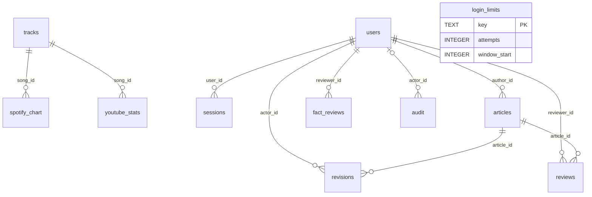

# K-POP DATA LAB 과제 답안 및 증거

기준일: 2026-10-20. 기준 브랜치 `feature/kpop-news-analysis`, STEP 24 커밋 `6e1c4d6e934289778f21200e63eefdb403bea001`.
사용자가 전달한 선생님 평가 항목을 적용했다. 원문 링크 접근 실패 후 추가 문서 검색 없이 상세 전달 기준으로 진행했다.
전체 과제 완료로 표시하지 않는다. 공통 오류 초안 자료와 예약 실행 증거가 남아 있다.

## 1 도메인 기획

주제는 K-POP 관련 곡의 Spotify·YouTube 성과와 뉴스의 근거를 설명하는 데이터 저널리즘이다.
주요 독자는 K-POP 팬, 음악 산업에 관심 있는 일반 독자, 차트 기사를 작성·검수하는 기자와 편집자다.
Spotify Global 주간 CSV, YouTube Weekly Top Songs CSV 및 YouTube Data API의 영상 통계가 출처다.
주간 곡 차트와 영상 누적 통계는 구분하며 플랫폼 사이의 재생량을 단순 합산하거나 인기 배수로 표현하지 않는다.

사람은 곡·녹음 버전·집계 기간·편집 분류를 먼저 확인한다. 기사 작성자와 다른 편집자가 숫자, 기간·단위,
근거 없는 주장, 출처의 네 항목을 확인해야 출고할 수 있다. AI가 기사를 만들었다는 사실은 승인 근거가 아니다.

## 2 기능정의와 화면 구성

| 기능 | 사용자와 입력 | 처리와 결과 | 구현 |
|---|---|---|---|
| 검색·분석 | 직원이 아티스트·곡 선택 | 최대 10명·10곡, 차트 비교 | app.py |
| 선택 제거·초기화 | 회원의 현재 선택 | 회원별 선택만 변경, 수집 데이터 삭제 아님 | app.py, security/auth.py |
| CSV 등록 | 로컬 담당자, 원본·출처 증거 | 검증·중복 방지·Manifest 등록 | news/chart_import.py |
| 근거 생성 | 등록 주차 | 원본 해시·수치·기간 대조, 미검수 보류 | news/weekly_facts.py |
| 기사 생성 | 직원, 검증 근거 | 무료 고정 초안 또는 명시적 유료 호출 | news/generation.py, news/news_routes.py |
| 기사 검수 | 기자·다른 편집자 | 수정 이력·4항목·승인 차단 | news/editorial.py |
| 회원·권한 | 회원·관리자 | scrypt, 세션, 역할별 접근 | security/auth.py, security/editorial_store.py |
| 원본 뉴스·지침 비교 | Notion 편집 작업 | 기사 3건과 v1/v2 초안 관계 | 아래 Notion 링크 |

화면 구성은 다음과 같다.

```text
/account 회원가입·로그인
    └─ / Dashboard
       ├─ 아티스트 검색·곡 선택
       ├─ Current Analysis / Spotify / YouTube / Compare 차트
       └─ NEWS ANALYSIS 주차·근거·무료 초안·유료 확인
/editorial 기사 작성·검수·역할 관리
    ├─ 기자: 저장 → 수정 → 검수 요청
    └─ 편집자: 본문·Fact Sheet → 체크리스트 → 보류 또는 승인
승인 기사 API /api/editorial/published
```

전체 역할별 브라우저 검증은 STEP 26에서 수행한다. 이번 실제 캡처는 로그인 화면이며 직원 검수 화면을 확인했다고 주장하지 않는다.

## 3 DB 구조와 ERD

현재 런타임은 MySQL 3개 테이블과 SQLite 8개 테이블이다. PostgreSQL SQL은 준비 자료일 뿐 실행 연결이 아니다.
MySQL SQL은 `mbc_kpop_data.sql`, SQLite SQL은 `db/migrations/002_editorial_sqlite.sql`이다.



두 저장소 사이에는 DB 외래키가 없다. Fact Sheet 경로·JSON·SHA-256으로 기사 근거를 연결한다.
`spotify_chart(song_id, chart_date)`와 `youtube_stats(youtube_video_id, collected_at)`의 UNIQUE가 중복을 막는다.
SQLite의 reviews·revisions·audit·fact_reviews는 UPDATE/DELETE 금지 트리거로 이력을 보존한다.
기사 삭제 대신 WITHDRAWN 철회를 사용한다. 평가용 CRUD에서는 자료 보존 목적의 철회임을 설명한다.

## 4 수집과 실행

실행 환경·의존성은 `requirements.txt`, `constraints-win-py314.txt`, `docs/environment_reproduction.md`를 따른다.
기존 `.env`는 공유하거나 재작성하지 않는다. 키 설정 예시는 `.env.example`이다.

```powershell
python -B scripts/run_local.py
python -B scripts/run_checks.py --report .reports/offline.json
python -B -m news.weekly_facts --week-end YYYY-MM-DD
python -B -m news.generation --mode template --week-end YYYY-MM-DD
```

실제 CSV 등록은 `docs/step21_chart_import.md`, DB 재현은 `docs/database_reproduction.md`,
기사 저장소 최초 설정은 `docs/step23_auth_editorial.md`를 따른다. 실행 안내 때문에 운영 DB를 초기화하지 않는다.
기존 생성 파일이 있으면 덮어쓰지 않는다. 유료 호출은 `--confirm-paid` 또는 웹 확인 절차가 필요하다.

## 5 기사 생성과 검수

`Manifest → 원본 CSV 해시·기간·수치 대조 → Fact Sheet → 곡·버전 사람 검수 → 기사 초안 → 출고 검수`.
상태 전이는 `DRAFT → PENDING_REVIEW → ON_HOLD → REVISED → PENDING_REVIEW → APPROVED`다.
하나라도 실패하면 승인 요청을 ON_HOLD로 남긴다. 자기 기사 승인을 거부하며 버전·근거가 바뀌면 재검수를 요구한다.
공개 조회도 근거를 재검증한다.

이번 보완은 새 생성 파일의 `generation_provenance`다. 실제 프롬프트 본문·버전·SHA-256,
모델 입력 JSON·SHA-256·출력 한도·store 설정을 모델 기록과 함께 남긴다.
CLI와 웹 경로 모두 적용하며 기존 프롬프트 문장과 API 반환 형식은 유지한다.
기존 기사 파일에는 과거 프롬프트를 추정하여 소급 기록하지 않는다.

기존 근거: `facts/article_ready_fact_sheet_20261008.json`.
기존 실제 AI 기사: `articles/draft_openai_20261008.json`와 `.md`.
편집 비교: `articles/editorial_review_20261008.md`, `articles/revised_editorial_v1_20261008.md`.
이 편집 자료는 선생님 지정 공통 오류 초안과 동일한 자료라는 증거가 없어 항목 06을 대체하지 않는다.

## 6 실제 시험 결과

| 시험 | 기대 결과 | 실제 결과 | 증거 |
|---|---|---|---|
| 인증·기사·Fact Sheet·프롬프트 기록 | 잘못된 상태·근거·권한 차단, 기록 일치 | 최종 고유 시험 35개 PASS | .reports/step25-targeted-initial.log, .reports/step25-targeted.log |
| 404·422·수정·보류→승인·철회 | 없는 기사/잘못된 입력 거부, 이력 보존 | 위 인증·기사 16개 시험에 포함 | tests/test_editorial_auth.py |
| SQLite 독립 프로세스 영속성 | 재연결 후 선택·기사·검수 유지 | PASS | test_selection_isolation_and_restart_persistence |
| MySQL 격리 실행 | 스키마·중복·FK·upsert·이전 보존 | 22 PASS, 0 FAIL, 0 SKIP | .reports/step25-mysql-isolated.json 및 실행 출력 |
| 운영 MySQL 읽기 전용 | 저장 존재·설계 명세 일치 | tracks 14, spotify_chart 23, youtube_stats 98; compatible=true | .reports/mysql-readonly.json |
| 실제 화면 | 로그인 화면 표시 | PASS 범위는 로그인 화면만 | .reports/step25-login.png |

35개 최초 실행은 34 PASS·1 ERROR였다. 새 CLI 시험의 임시 출력 경로가 프로젝트 밖이어서 오류가 났고,
시험 경로를 프로젝트 안으로 고친 뒤 해당 모듈 3개가 모두 통과했다. 총 57개 고유 시험의 최종 결과가 PASS다.
초기 샌드박스 임시 폴더 권한 오류는 `.reports/step25-targeted-sandbox.log`에 별도 보존했다.
STEP 24의 154 PASS / 0 FAIL / 16 SKIP을 이번 결과에 더하지 않는다.
이번에는 기존 MySQL 시험 16개가 실제 격리 DB에서 실행됐고 정책 검사 6개도 통과했다.

## 7 Notion과 예약

- [STEP 25 개발 기록](https://app.notion.com/p/3ff16efa972b819eaef9edbab9935ee9)
- [원본 기사 DB](https://app.notion.com/p/0958e12454f040d9941149af7f3860a3)
- [생성 기사 DB](https://app.notion.com/p/d0666491088b48be86adae41a75b8510)
- [지침 v1 v2 및 비교표](https://app.notion.com/p/3ff16efa972b81a6b390e56161dd135f)

원본은 The Korea Times/연합뉴스 보도 2건과 Spotify 기업 발표 1건이다. 발행일·본문·숫자를 확인하고
전문 복제 없이 URL·요약·핵심 수치·사용 한계를 저장했다. 기업 발표와 독립 언론 보도를 구분했다.
같은 3건을 입력으로 v1/v2 초안 2건을 이 대화에서 생성해 원본 관계로 연결했다.
원시 통계의 독립 재검증이나 사람 출고 승인은 아니다. 별도 유료 API를 호출하지 않았다.

사용자 승인으로 매일 09:00 Asia/Seoul 예약 `k-pop`을 활성화했다. 새 원본 최대 3건을 중복 확인 후 등록하고
지침 v2 초안을 검토 대기로 저장한다. 운영 웹 DB·사람 승인·공개 발행과 분리한다.
이번 등록은 수동 실행 증거이며 스케줄러가 예약 시각에 실행한 증거는 아직 없다.

## 8 Git과 비밀키

- [GitHub 브랜치](https://github.com/dominickim77-ui/mbc-kpop-data/tree/feature/kpop-news-analysis)
- `1e88cfe` CSV 등록 검증
- `86f4434` 주차 Fact Sheet와 기사 생성 연결
- `fa01d88` 인증과 사람 검수 승인
- `6e1c4d6` PostgreSQL 준비와 검증 안정화

현재 Git 추적 대상에서 `.env`, `data/private/`, `*.sqlite3`가 제외됨을 확인했다.
이 확인만으로 Git 전체 과거 이력의 비밀키 무노출을 보증하지 않는다.
이번 변경에는 키·운영 DB·기존 승인 기록을 넣지 않는다. Commit·Push는 사용자 조건부 승인을 받았으며 실제 원격 반영 결과는 Notion 종료 기록에 남긴다.
작업 대화 공유 링크: https://chatgpt.com/s/cx_6ad6df665a6c819199d8c8d948b35df8
이 링크는 STEP 25 작업 대화의 생성 시점 스냅샷이며 원래 10.20 실습 대화의 공유본은 아니다.
Notion 링크는 기록 접근 링크이며 공개 접근 설정 완료를 뜻하지 않는다.

## 9 남은 필수 항목

1. 선생님 공통 오류 초안·원자료를 받아 대조·수정: BLOCKED.
2. 예약 시각의 실제 실행 결과 및 Notion 등록 로그 확보: PARTIAL.
3. 실제 직원별 작성·검수 화면과 차트 값 검증: STEP 26.
4. 제출자가 GitHub·Notion·작업 대화 링크에 접근할 수 있는지 확인.
5. STEP 25 변경 Commit·Push 사용자 승인 확보. 최종 원격 SHA는 Notion 종료 기록 참조.
6. PostgreSQL 앱 어댑터·이전·영속 파일·보안은 STEP 27 배포 전 필수. 현재 미완료이며 이번 단계에서 배포하지 않는다.

## 종료 시 추가 확인한 제출 조건

사용자가 2026-10-20 승인한 12개 파일의 Commit·Push 범위로 종료한다. 실제 커밋·원격 SHA 확인 결과는 Notion STEP 25 종료 기록을 참조한다.
원본 기사 발행일은 2026-01-16, 2025-08-05, 2026-10-16이다. 2026-10-20 제출 기준 선생님 예시의 최근 3일 조건을 충족하지 않는다. 기존 3건은 지침 비교 자료로 보존하고, 최근 3일 조건에 맞는 원본 확보 및 연결 초안 보완을 STEP 26 잔여로 인계한다.
따라서 항목 08은 PARTIAL로 정정한다. 최종 분류는 확인 완료 7개, PARTIAL 2개(08·10), BLOCKED 1개(06)다.
기존 DOCX·ZIP은 승인 전 산출물로, Word 화면 검증과 항목 08·종료 상태의 갱신이 필요하다. 이번 단계 종료는 전체 과제 완료나 배포 완료를 뜻하지 않는다.
